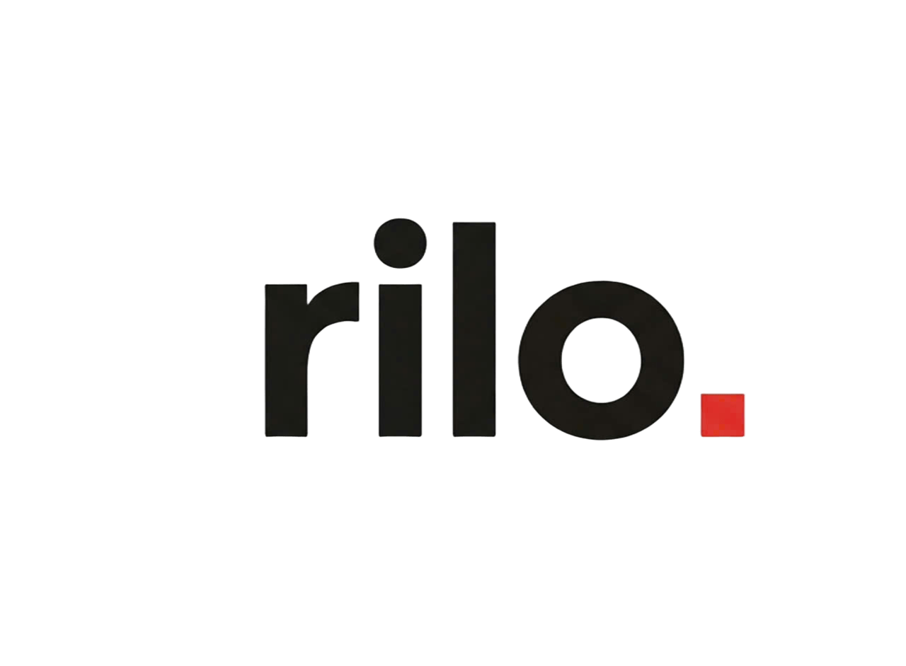

<div align="center">

  <p align="center">
    
  </p>
  
  ### Hệ thống Trích xuất & Xử lý Thông tin Tài liệu Thông minh
  **Fine-tuned PaddleOCR** × **Local Qwen 2.5**

  [](https://www.python.org/)
  [](https://github.com/PaddlePaddle/PaddleOCR)
  [](https://github.com/QwenLM/Qwen2.5)
  [](https://developer.nvidia.com/cuda-toolkit)
  [](LICENSE)

</div>

---

## Giới thiệu

**rilo.** là giải pháp trích xuất dữ liệu tài liệu tự động (Document Information Extraction) chạy hoàn toàn **on-premise / local**, đảm bảo tính bảo mật và quyền riêng tư tuyệt đối cho dữ liệu doanh nghiệp.

Quy trình hoạt động kết hợp sức mạnh của:
1. **Fine-tuned PaddleOCR:** Tối ưu hóa nhận diện chữ viết (text detection & recognition) cho các loại văn bản, hóa đơn, biểu mẫu đặc thù với độ chính xác cao.
2. **Local Qwen 2.5 (LLM):** Phân tích ngữ cảnh, chuẩn hóa lỗi chính tả và trích xuất thông tin theo lược đồ JSON có cấu trúc (Structured JSON Extraction) mà không cần gửi dữ liệu ra bên ngoài.

---

## Kiến trúc luồng xử lý (Pipeline)

```text
  [ File Ảnh / PDF / Hóa đơn ]
                 │
                 ▼
  [ Fine-tuned PaddleOCR Engine ]
        ├── Text Detection (Fine-tuned trên dữ liệu đặc thù)
        └── Text Recognition 
                 │
                 ▼
  [ Layout & Prompt Reconstruction ]
        ├── Ghép nối tọa độ Bounding Box & dòng văn bản
        └── Đóng gói System Prompt chuẩn hóa
                 │
                 ▼
  [ Local Qwen 2.5 Engine ]  (chạy qua vLLM / Ollama / Transformers)
        ├── Sửa lỗi ký tự OCR gây hiểu nhầm
        ├── Suy luận quan hệ ngữ nghĩa (Key-Value Matching)
        └── Ràng buộc đầu ra (JSON Schema / Pydantic)
                 │
                 ▼
  [ Kết quả JSON Chuẩn cấu trúc ]
```

---

## Tính năng chính

- **OCR độ chính xác cao:** Model PaddleOCR đã được tinh chỉnh (fine-tune) sâu, giải quyết tốt các trường hợp chữ mờ, font chữ đặc thù, bảng biểu phức tạp.
- **Bảo mật 100% (Local First):** Qwen 2.5 chạy trực tiếp trên GPU máy chủ nội bộ; không phát sinh API cost từ bên thứ ba và không lộ dữ liệu nhạy cảm.
- **Trích xuất JSON chuẩn xác:** Trích xuất tự động các trường thông tin (Số hóa đơn, Tổng tiền, Tên công ty, Ngày cấp, Mặt hàng, v.v.).
- **Tùy biến Backend linh hoạt:** Hỗ trợ chạy Qwen 2.5 qua **Ollama**, **vLLM** (đạt throughput cao) hoặc **HuggingFace Transformers**.

---

## Yêu cầu hệ thống

- **Hệ điều hành:** Linux (Ubuntu 20.04/22.04 khuyến nghị) hoặc Windows 11 qua WSL2
- **Python:** `>= 3.10`
- **Phần cứng:** 
  - GPU NVIDIA có tối thiểu 12GB - 16GB VRAM (khuyến nghị cho Qwen 2.5 7B/14B Q4_K_M hoặc FP16)
  - Đã cài đặt CUDA Toolkit và cuDNN tương thích

---

## Cài đặt

### 1. Clone repository
```bash
git clone https://github.com/username/rilo.git
cd rilo
```

### 2. Thiết lập môi trường ảo
```bash
python -m venv venv
source venv/bin/activate  # Trên Windows: venv\Scripts\activate
pip install -r requirements.txt
```

### 3. Cài đặt PaddlePaddle GPU
```bash
# Chọn bản build phù hợp với phiên bản CUDA của máy bạn
python -m pip install paddlepaddle-gpu -i https://www.paddlepaddle.org.cn/packages/stable/cu118/
```

### 4. Thiết lập mô hình

#### A. Trọng số PaddleOCR (Fine-tuned)
Đặt thư mục checkpoint / model inference của bạn vào:
```text
models/paddle_ocr/
├── det/
└── rec_finetuned/
```

#### B. Khởi chạy Local Qwen 2.5
Bạn có thể sử dụng **Ollama** để phục vụ Qwen 2.5 nhanh chóng:
```bash
# Tải và chạy Qwen 2.5 (ví dụ bản 7B hoặc 14B)
ollama run qwen2.5:7b
```
Hoặc cấu hình đường dẫn local weights trong `.env` nếu chạy trực tiếp bằng `transformers` / `vLLM`.

---

## Hướng dẫn sử dụng

### 1. Cấu hình biến môi trường
Tạo file `.env` từ file mẫu:
```bash
cp .env.example .env
```
Nội dung `.env`:
```env
# Cấu hình OCR
PADDLE_OCR_DET_PATH="./models/paddle_ocr/det"
PADDLE_OCR_REC_PATH="./models/paddle_ocr/rec_finetuned"
USE_GPU=True

# Cấu hình LLM
LLM_PROVIDER="ollama"          # "ollama", "vllm", hoặc "transformers"
OLLAMA_BASE_URL="http://localhost:11434"
LLM_MODEL_NAME="qwen2.5:7b"
```

### 2. Chạy thử nghiệm trên terminal
```bash
python main.py --image samples/invoice_sample.jpg --output result.json
```

### 3. Tích hợp bằng Python Code

```python
from rilo.pipeline import DocumentPipeline

# Khởi tạo pipeline
pipeline = DocumentPipeline(config_path="config.yaml")

# Trích xuất dữ liệu từ hình ảnh
result = pipeline.process(
    image_path="samples/bill.png",
    schema="schemas/invoice_schema.json"
)

print(result)
# Output:
# {
#   "invoice_number": "HD-2024-0091",
#   "total_amount": 1250000,
#   "date": "2024-11-05"
# }
```

---

## Cấu trúc thư mục

```text
rilo/
├── assets/
│   └── logo.png              # Logo rilo.
├── configs/
│   └── config.yaml           # Thiết lập tham số OCR và prompts cho LLM
├── models/
│   └── paddle_ocr/           # Chứa model PaddleOCR sau khi fine-tune
├── schemas/                  # Định nghĩa định dạng JSON cần trích xuất (JSON Schema / Pydantic)
├── src/
│   ├── ocr/                  # Xử lý nhận diện PaddleOCR
│   ├── llm/                  # Tích hợp Qwen 2.5 (Prompt, Client)
│   ├── pipeline.py           # Luồng kết nối OCR -> Prompt -> LLM
│   └── utils.py
├── tests/
├── .env.example
├── requirements.txt
└── README.md
```

---

## Đánh giá mô hình (Benchmarking)

| Giai đoạn | Mô hình gốc | Mô hình rilo. | Cải thiện |
| :--- | :--- | :--- | :--- |
| **OCR Recognition (Acc)** | ~81.2% | **~96.4%** | +15.2% |
| **JSON Extraction Precision** | ~74.0% | **~93.8%** | +19.8% (Nhờ Qwen 2.5) |

---

## Đóng góp

Mọi đóng góp, báo cáo lỗi (Issues) hoặc cải tiến (Pull Requests) đều được chào đón:
1. Fork dự án
2. Tạo branch mới (`git checkout -b feature/tinh-nang-moi`)
3. Commit thay đổi (`git commit -m 'feat: them tinh nang'`)
4. Push lên branch (`git push origin feature/tinh-nang-moi`)
5. Tạo Pull Request

---

## Bản quyền (License)

Dự án được phân phối dưới giấy phép [MIT License](LICENSE).
